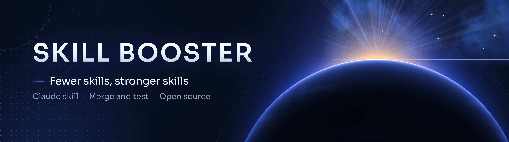

<p align="center">
  
</p>

<p align="center">
  
  
  
</p>

# skill-booster — Skill Booster

**Moins de skills, plus forts : il améliore et regroupe des skills existants au lieu d'en multiplier, avec un chiffre avant/après à chaque fusion.**
*Fewer skills, stronger skills: merge, test before/after, archive, never delete.*

## ✦ Ce que fait le skill

| | |
|---|---|
| **Mesure** | `analyser.py` : doublons, trous, références manquantes, chemins privés. |
| **Décision** | FUSIONNER, APPELER, GARDER SÉPARÉ ou REJETER, justifié. |
| **Preuve** | Tests avant/après écrits avant le travail ; originaux archivés, rien supprimé. |
| **Relecture** | Il se relit comme un étranger qui n'a jamais vu le projet, puis se corrige. |

## ✦ Installation

**Télécharger** : bouton vert **Code → Download ZIP**, ou :

```bash
git clone https://github.com/horizonchapter/skill-booster.git
```

**Claude Code** (pour tous tes projets) :

```bash
cp -r skill-booster/skills/skill-booster ~/.claude/skills/
```

**Claude (app et web)** : importe le fichier [`skill-booster.zip`](skill-booster.zip) dans les réglages des skills de Claude.

## ✦ Utilisation

- « Fusionne ces deux skills. »
- « J'ai trop de skills. »
- `python skills/skill-booster/scripts/analyser.py --selftest`

## ✦ Crédits

Méthode de base : skill-creator (Anthropic), à laquelle ce skill ajoute la fusion, l'archivage et la relecture.

## ✦ Structure

```
skill-booster/
├── skills/skill-booster/
│   ├── SKILL.md
│   ├── references/   test avant/après, relecture d'étranger
│   ├── scripts/      analyser.py
│   └── exemples/     fusions réelles (anonymisées)
├── skill-booster.zip
└── assets/             bannière
```

## ✦ Voir aussi

[design-horizon](https://github.com/horizonchapter/design-horizon) · [publication-sure](https://github.com/horizonchapter/publication-sure) · [memoire-relais](https://github.com/horizonchapter/memoire-relais) · [pdf-sobre](https://github.com/horizonchapter/pdf-sobre) · [decision-business](https://github.com/horizonchapter/decision-business) · [clearmind](https://github.com/horizonchapter/clearmind)

## ✦ Licence

[MIT](LICENSE). Historique des versions : [CHANGELOG](CHANGELOG.md).
